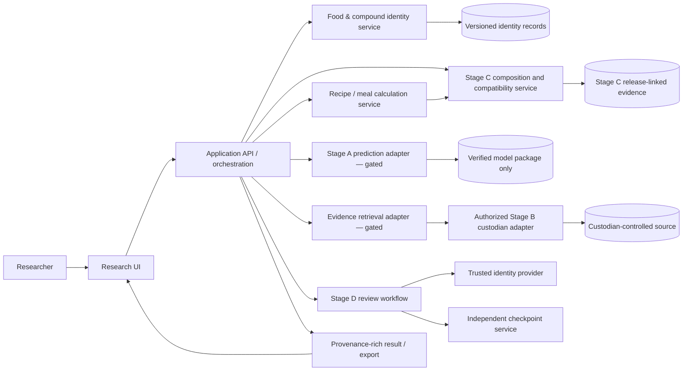

# CookRisk Research Prototype — System Architecture

**Planning blueprint — 17 November 2026**  
Supplementary design only. It does not replace the official Stage A–D roadmap or authorize protected data access.

## 1. Architecture principles

- Keep source evidence, derived calculations, model predictions, and human decisions as distinct record types.
- Every value carries an identifier, unit, basis/sample state, source reference, version, and status.
- Never infer missing provenance, moisture conversion, cooking yield, retention, reviewer approval, or clinical meaning.
- Stage services expose narrow versioned interfaces; adapters enforce access boundaries.
- When evidence, authorization, or a required service is absent, return a typed unavailable/blocked state with the reason. Do not silently fall back to synthetic or stale data.
- A successful API response means the service returned a contract-valid response; it does not certify scientific validity.

## 2. Logical architecture



The diagram is a target logical architecture. Existing components and contracts are described in repository documentation, but the diagram does not assert that every service is currently deployed or operational. Stage B data remains in its custodian-controlled environment; no copied Stage B database is proposed.

## 3. Components and interface contracts

### Research UI

**Inputs:** food/compound search, cooking method and conditions, ingredient mass, cooked yield, servings, amount consumed, optional leftovers.  
**Outputs:** raw evidence, eligibility gate explanation, supported arithmetic, unavailable reason, source links, review status, reproducibility export.  
**Units/provenance:** preserve user-entered unit and normalized unit side by side; display source ID and release/version for retrieved evidence.  
**Missing behavior:** show a typed “unavailable” panel and missing fields; never render `0` as a substitute for unknown.  
**Failure:** distinguish app health, scientific data availability, authentication availability, and calculation validity.

### Application API / orchestration

**Inputs:** versioned JSON requests with stable food, compound, scenario, and recipe identifiers.  
**Outputs:** versioned typed responses with `status`, `value` or null, `unit`, `quantity_type`, provenance references, assumptions, uncertainty, and `limitations`.  
**Failure:** fail closed on invalid schema, unresolved identity, incompatible evidence, protected-source authorization failure, invalid signatures, or integrity mismatch. No review write may occur before trusted identity authorization.

### Identity service

**Inputs:** source identifier/name and candidate food/compound identity.  
**Outputs:** stable ID, canonical form, crosswalk evidence, identity status, source, and ambiguity list.  
**Units:** not applicable; compound structure should retain canonical structure and identifier namespaces.  
**Missing behavior:** unresolved/ambiguous, not guessed. **Acceptance gate:** source-supported crosswalk and, where required, qualified review.

### Stage C composition and compatibility service

**Inputs:** food ID, compound ID, ordinary-food/context category, raw measurement, sample state, basis, unit, source, and cooking evidence.  
**Outputs:** raw value plus compatibility decision for each food–compound–preparation tuple. Return a cooked value only when all acceptance gates pass.  
**Units:** original unit is immutable; conversion output includes formula and both units. Record as-received, as-analyzed, dry-weight, lyophilized, and unknown as distinct basis values.  
**Provenance:** source record ID, release, exact source locator, method, conditions, and evidence-quality status.  
**Missing behavior:** a reason-coded unresolved result (e.g. identity, basis, method, unit, yield, retention quality). Do not assume dry-weight conversion or infer retention from loss.  
**Failure:** incompatible records are rejected from calculation but retained for audit.

### Recipe/meal service

**Inputs:** supported ingredient composition and quantity, preparation, measured cooked yield/mass, servings, consumed fraction, and leftovers.  
**Outputs:** arithmetic for the meal/serving in a declared unit, component-level contribution, source references, and uncertainty only when supported.  
**Formula contract:** amount in meal is based on compatible concentration × consumed food quantity; mass-retention calculations require pre/post masses or a valid measured yield. The exact formula depends on the accepted quantity type and must be explicit in each output.  
**Missing behavior:** do not calculate total meal exposure where a required ingredient estimate or consumed amount is absent; provide partial components labelled partial, never imply complete total.

### Stage A prediction adapter (disabled until gates pass)

**Inputs:** only the verified feature schema, domain fields, and a versioned scenario; reject out-of-domain input.  
**Outputs:** experimental predicted ACR with unitless percent scale, interval/uncertainty method, model ID, training-snapshot hash, feature/preprocessing version, and validation domain.  
**Required provenance:** exact training data hash, code/config, environment lock, model artifact hash, fold/external validation report.  
**Missing behavior:** no prediction if model or snapshot is unverified, or if new input is outside validated domain. Never substitute OOF predictions as new-record inference.  
**Current gate:** documented Stage A source-held-out performance is negative and independent strict replication is absent; no deployable package is established in the cited records.

### Evidence retrieval adapter (Stage B protected boundary)

**Inputs:** authorized query identifiers and scope token from the custodian-managed interface.  
**Outputs:** evidence references and permitted claim metadata, not unapproved bulk copies.  
**Provenance:** source/study, locator, version, access policy, extraction status, and reviewer decision.  
**Missing behavior:** `UNAVAILABLE_AUTHORIZATION_REQUIRED` or `SOURCE_NOT_PROVISIONED`; never fabricate an empty result as proof that no interaction exists.  
**Boundary:** Stage B files, snapshots, and embedded copies are not part of this planning inspection. The actual contract and source truth need custodian verification.

### Stage D review service

**Inputs:** stable record ID, reviewer identity/qualification, assignment, decision, rationale, cited evidence, date, and signature.  
**Outputs:** pending/assigned/in-review/approved/rejected/needs-revision state plus tamper-evident audit reference.  
**Provenance:** preserve prior state, actor, timestamp, evidence versions, and signature verification outcome.  
**Missing behavior:** reject final decisions without real trusted identity, qualification, required rationale/evidence, and intact audit/checkpoint service. Keep status pending.  
**Current gate:** documented 342 records remain pending; identity/checkpoint integrations and qualified human decisions remain outstanding.

### Output/reporting layer

Each result/export should include request ID, creation time, app/data/model versions, input IDs, formula, units, provenance, compatibility gate outcomes, uncertainty method or explicit absence, human-review status, and limitations. Avoid a singular “risk” output. Export only data the current authorization permits.

## 4. Canonical response shape (proposal)

```json
{
  "status": "UNAVAILABLE_EVIDENCE",
  "quantity_type": "cooked_concentration",
  "value": null,
  "unit": "mg/kg as-eaten",
  "provenance": [],
  "compatibility": {
    "food_identity": "PASS",
    "compound_identity": "PASS",
    "sample_state": "UNRESOLVED",
    "measurement_basis": "UNRESOLVED",
    "cooking_conditions": "NOT_ESTABLISHED",
    "unit_compatibility": "NOT_EVALUATED",
    "yield_or_mass": "MISSING",
    "retention_evidence": "MISSING"
  },
  "uncertainty": null,
  "limitations": ["No compatible accepted cooked measurement is available"]
}
```

This is a design example, not an existing API contract. Adopt it only through an authorized implementation task and align it to existing registered contracts first.

## 5. Integration sequence

1. Freeze interface schemas and status vocabulary with task owners.
2. Validate Stage C calculation contracts with synthetic fixtures and independent arithmetic.
3. Connect read-only raw composition and recipe arithmetic with provenance.
4. Provision Stage D auth/checkpoint services before live review writes.
5. Obtain authorized Stage B adapter contract and custodian provisioning.
6. Keep Stage A prediction adapter unavailable until reproducible artifact and external validation gates pass.
7. Run integration tests against approved fixtures/snapshots; test outage, missing data, integrity mismatch, and authorization failures.
8. Demonstrate each result with a downloadable trace; document that it is research output, not clinical advice.

## 6. Deployment and security boundary

Local prototype mode should distinguish UI availability from data/service availability. Bind locally by default; do not expose ports publicly without an approved deployment design. Secrets belong in an approved secret manager, not repository files. Use read-only scoped data adapters for scientific sources. Audit any export of restricted evidence. An app can be healthy while a protected dataset or external provider is unavailable; health responses should represent those dimensions separately.
