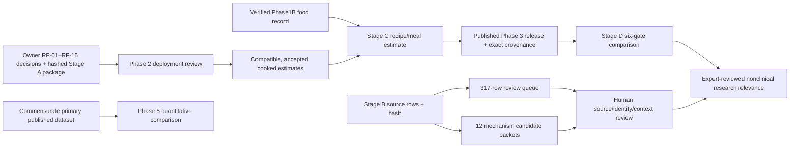

# CookRisk advanced parallel execution report

Execution date: **2026-11-04**  
Workspace: `C:\Users\dakshant\Desktop\CookChem`  
Scope: Stage C advancement, Stage D expansion, a local non-production application, testing, and integration readiness.

## A. Executive summary

This execution produced concrete work across the requested tracks:

- Phase 2 now has a metadata-only Stage A package validator, an acceptance schema, an owner handoff for all 15 target questions, and synthetic mutation tests. Its deployment gate remains blocked pending scientific and model-owner decisions; the Stage C Phase 2 roadmap remains **IN_PROGRESS**.
- Phase 4 now carries structured input-uncertainty provenance, propagates supported raw-food input intervals, reports coverage, and ranks additive sensitivity by compound. Synthetic recipe and meal bounds pass deterministic endpoint tests.
- Seven primary onion/quercetin studies were screened against the current Stage C measurement. None is scientifically commensurate, so no values were extracted into a fixture and no published-data comparison was run.
- The Stage D mechanism registry grew from 3 to 12 source-pinned candidates across 6 primary studies. All remain pending independent review.
- A reproducible machine triage queue now preserves all 317 Stage B evidence rows, with human review still `NOT_REVIEWED` for every row.
- Stage D has a nonclinical, categorical research-interpretation design foundation. It creates no numerical risk score or clinical conclusion and requires explicit expert review before its research-relevance state can be reached.
- A local browser prototype now uses the existing Stage C calculator and Stage D contracts for food search, recipes/meals, evidence search, comparison gates, uncertainty display, and JSON/CSV export.

Final verification: Stage C **239 passed**, Stage D **46 passed**, Phase 3-v0.1.2 isolated tests **79 passed**, and the Phase 4 registry suite **13 passed**. All **27** working Stage C, Stage C Phase 4, and Stage D JSON schemas passed Draft 2020-12 metaschema checks. No suite had a final failure or skip.

## B. Original roadmap status

| Roadmap phase | Status | Evidence and remaining limit |
|---|---|---|
| Stage C Phase 1 — Software Foundation | **COMPLETE** | Existing calculation, provenance, validation, and release-integrity foundation remains in use. Regression suite passes. |
| Stage C Phase 1B — Scientific Food Data Acquisition | **COMPLETE_WITH_DOCUMENTED_LIMITATIONS** | Phase1B-v1.3.2 is pinned and verified. Identity, scope, and measurement limitations remain in its reports. |
| Stage C Phase 2 — Cooking-Retention Integration | **IN_PROGRESS** | Phase2-v0.3.1 is a verified bounded evidence release with **0 accepted cooked-concentration estimates**. Deployment closure needs owner answers, an approved model/serving contract, target denominator/basis, a complete runtime package, and scientific compatibility review. The Stage A prediction subtask is **BLOCKED** until those artifacts and decisions arrive. |
| Stage C Phase 3 — Recipe and Meal Exposure | **COMPLETE_WITH_DOCUMENTED_LIMITATIONS** | Existing engine calculates raw-reference estimates and guarded cooked intervals. Cooked estimates remain unavailable without compatible accepted Phase 2 evidence and measured cooked yield. |
| Stage C Phase 4 — Uncertainty and Sensitivity | **IN_PROGRESS** | Structured source-bounded raw-input propagation, coverage, recipe/meal aggregation, and deterministic ranking are implemented and tested. Cooked multi-input uncertainty and probability distributions are not available. |
| Stage C Phase 5 — Exposure Validation and Benchmarking | **COMPLETE_WITH_DOCUMENTED_LIMITATIONS** | Arithmetic/reference validation and a seven-study literature screen exist. No study met the current direct-quercetin comparison criteria; no external validation occurred. |
| Stage C Phase 6 — User-Facing Application | **IN_PROGRESS** | Functional local prototype and handler/API tests are implemented. It is not production-ready and has no authentication, persistent review state, or live browser screenshot verification. |
| Stage C Phase 7 — Finalization | **IN_PROGRESS** | No new immutable release was created. Integration, owner decisions, and scientific review remain outstanding. |
| Stage D Phase 1 — Evidence–Exposure Integration Architecture | **COMPLETE_WITH_DOCUMENTED_LIMITATIONS** | Existing exact-ID and provenance contracts remain the foundation; full scientific linkage still requires a published Phase 3 result and review. |
| Stage D Phase 2 — Evidence Normalization and Classification | **COMPLETE_WITH_DOCUMENTED_LIMITATIONS** | Deterministic source-text normalization is used for triage; it does not verify sources or adjudicate identity. |
| Stage D Phase 3 — Exposure–Evidence Comparability | **COMPLETE_WITH_DOCUMENTED_LIMITATIONS** | Six tri-state gates and exact cross-stage contracts exist. The local UI only evaluates standalone gates when no verified published Phase 3 estimate is selected. |
| Stage D Phase 4 — Mechanism-Based Integration | **IN_PROGRESS** | Registry contains 12 source-pinned candidate records; all 12 await independent manual review, and none is expert-approved. |
| Stage D Phase 5 — Uncertainty and Evidence Assessment | **IN_PROGRESS** | Machine triage queue covers all 317 rows. Human review, source verification, and expert adjudication remain untouched. |
| Stage D Phase 6 — Risk Interpretation Framework | **IN_PROGRESS** | A sourced nonclinical design and synthetic category tests exist. No expert-approved policy or clinical interpretation exists. |
| Stage D Phase 7 — Validation and Benchmarking | **NOT_STARTED** | There is no independent clinical outcome benchmark or external validation. Software tests do not satisfy this phase. |
| Stage D Phase 8 — Application and Reporting | **IN_PROGRESS** | Local evidence search, source details, mechanism candidates, comparison gates, and exports are available in the prototype. |
| Stage D Phase 9 — Final Integration and Release | **IN_PROGRESS** | Foundations and integration tests are present; no new immutable release was issued and scientific review remains open. |

## C. Workstream results

### A — Phase 2 deployment closure preparation

Added [deployment_package.py](../src/stage_c/deployment_package.py), [the deployment acceptance schema](../schemas/stage_a_deployment_manifest.schema.json), and synthetic tests. The validator checks safe package paths, file inventory hashes/sizes, referenced-file hashes, runtime metadata, ordered feature/preprocessing contracts, target semantics/units/denominator/basis, and output-schema metadata. It only inspects metadata and bytes: it never loads a model, runs inference, or authorizes inference. All valid package checks remain `PENDING_REVIEW` until an owner supplies and reviewers accept the scientific/deployment decisions.

The owner response template consolidates **RF-01–RF-15** with the scientific reason, repository evidence, required decision and supporting artifact, and consequence of leaving each unanswered. See [RETENTION_FINAL_OWNER_RESPONSE_TEMPLATE.md](phase2/RETENTION_FINAL_OWNER_RESPONSE_TEMPLATE.md), [STAGE_A_INTEGRATION_READINESS.md](phase2/STAGE_A_INTEGRATION_READINESS.md), and [PHASE2_STAGE_A_DEPLOYMENT_PACKAGE_SPEC.md](phase2/PHASE2_STAGE_A_DEPLOYMENT_PACKAGE_SPEC.md).

Focused deployment tests: **9/9 passed**. No Stage A prediction was generated or consumed.

### B — Phase 4 uncertainty and sensitivity

The recipe engine now preserves `provenance.uncertainty_inputs` and the normalized full ingredient quantity. The uncertainty module reports per-estimate coverage for food concentration, quantity, serving size, serving/consumed fractions, serving count, and cooking retention. It propagates raw-food interval endpoints only when all required multiplicative factors have explicit, correctly typed, source-referenced bounds. Missing factors withhold the total interval. Sensitivity totals reject mixed compounds and are grouped per compound by the application.

Top-level recipe and meal-aggregation bounds are validated and shown in coverage, but are not multiplied into amounts until their source-specific meaning and application point are defined. The combined cooked-input uncertainty path also remains unavailable.

Existing Phase 2 cooked intervals remain conditional on point-valued concentration, cooked quantity, and fractions. No combined cooked-input uncertainty contract or Monte Carlo layer was introduced. See [UNCERTAINTY_IMPLEMENTATION.md](phase4/UNCERTAINTY_IMPLEMENTATION.md), [uncertainty.py](../src/stage_c/uncertainty.py), and [uncertainty_inputs.schema.json](../schemas/uncertainty_inputs.schema.json).

Focused uncertainty and app suites: **12/12 passed**, including source-bound propagation, missingness, lower/upper recipe and meal aggregation, sensitivity, schema mutation, and no cooked-value substitution.

### C — Published-data screening

Seven primary studies were screened against Stage C food record `B011-HPLC-06` (direct quercetin aglycone, fresh-weight edible onion, mg/100 g). All were excluded from numerical comparison:

| Candidate | Main exclusion reason |
|---|---|
| PUB-001 — Watanabe et al. (2018) | Strongest cooking design, but reports total hydrolysis-released quercetin aglycone-equivalents rather than direct free aglycone; cultivar and matched Stage C cooked endpoint also differ. |
| PUB-002 — Cattivelli et al. (2021) | Flavonols are quantified as quercetin-3-O-glucoside equivalents; the current row uses direct quercetin calibration, and cultivar/endpoint do not match. |
| PUB-003 — Nishimuro et al. (2015) | Reports total hydrolyzed quercetin, with raw/cooked pairing and cooked yield insufficiently resolved. |
| PUB-004 — Németh et al. (2004) | Measures quercetin glycosides; fresh-weight compatibility, cooked solids yield, and replication were not verified. |
| PUB-005 — Harris et al. (2015) | Measures glycosides; full quantitative table units/basis and yield were not independently accessible. |
| PUB-006 — Lombard et al. (2005) | Free-aglycone values, table units/basis, full analytical method, and cooked yield could not be verified from accessible material. |
| PUB-007 — Ioku et al. (2001) | Abstract-level record concerns glycosides; numerical tables, units, basis, conditions, and replication were not verified. |

No numerical source values were copied from abstracts, secondary reproductions, or unverified graphs. No quantitative fixture was created; `compare_to_reference()` and external validation were not run. Full bibliography, locators, conditions, method/replication, and gate rows are in [the source registry](phase5/published_candidates/source_registry.json), [the comparability matrix](phase5/published_candidates/comparability_matrix.csv), and [the screening report](phase5/published_candidates/PUBLISHED_DATASET_SCREENING_REPORT.md).

### D — Mechanism-based integration

The mechanism registry preserves the original three records and adds nine source-checked Stage B records, for **12 candidates across six primary studies**. Source review status is 10 full-text/full-manuscript and 2 primary-abstract-only. The original Stage B row strings are retained; the PMID 22300367 endpoint discrepancy remains explicitly documented. All records are `pending_manual_review`; identity adjudication and expert acceptance are not claimed. See [the mechanism report](../../stageD/reports/phase45_mechanism_registry_report.md) and [reviewer packets](../../stageD/reports/mechanism_reviewer_packets.md).

### E — Stage D evidence assessment queue

The deterministic queue preserves every row and Evidence_ID from StageB_V20_20261103 and pins the source digest `358665c3…a3b8e6`.

| Machine triage / inventory | Rows |
|---|---:|
| `CONFLICT_REVIEW` | 63 across 45 explicit source groups |
| `IDENTITY_PENDING` | 199 |
| `READY_FOR_EXPERT_REVIEW` | 55 (required metadata present; not source-verified or accepted) |
| Human review `NOT_REVIEWED` | 317 |
| Exact duplicate candidates | 0 (semantic duplicates are not ruled out) |
| Source-verified / expert-accepted / expert-rejected | 0 / 0 / 0 |

The source-text polarity inventory is 182 positive, 8 negative, 13 null, 63 conflicting, and 51 unclear. No record was marked negative by missingness or machine triage. See [the queue report](../../stageD/reports/phase5/evidence_review_queue_report.md) and [the reproducible queue](../../stageD/data/evidence_review_queue.json).

### F — Nonclinical interpretation design

The framework separates evidence strength, source review, identity, mechanism, experimental context, outcome, dietary exposure, comparability, uncertainty, conflict, human relevance, and expert review. It defines the requested categories, states precedence, preserves negative/null findings as condition-specific, and makes mechanism-only evidence insufficient for research relevance. A research-relevance state requires full-text source review, verified identity, documented exposure comparability, available dietary exposure, bounded uncertainty, and explicit expert support. This is a design rule set, not an FDA/ICH-endorsed classifier.

The source-grounded design discusses the [ICH M12 final guideline (2024)](https://database.ich.org/sites/default/files/ICH_M12_Step4_Guideline_2024_0521_0.pdf) and [FDA food-effects guidance](https://www.fda.gov/regulatory-information/search-fda-guidance-documents/assessing-effects-food-drugs-inds-and-ndas-clinical-pharmacology-considerations). Those sources concern drug-interaction and food-effect study contexts; they are not direct validation standards for food-compound interaction predictions. Synthetic cases exercise all categories. No actual expert decision or clinical interpretation was entered. See [INTERPRETATION_FRAMEWORK_DESIGN.md](../../stageD/reports/phase6/INTERPRETATION_FRAMEWORK_DESIGN.md).

### G — Functional local application prototype

The local-only server and two-section browser UI are in [stageC/app](../app/README.md). Stage C supports catalog search, multi-ingredient recipes, quantities/units, serving and consumed fractions, raw/cooked state, cooking descriptors, meal aggregation, source/mapping/release provenance, uncertainty coverage, and JSON/CSV export. Stage D supports 317-row evidence search, category filtering, original outcome/source details, mechanism candidates, six tri-state comparison gates, and an explicit pending/review boundary.

The server uses the existing `recipe_engine`, uncertainty module, Stage D normalizer, and comparability gate. It verifies the pinned release adapters and Stage B source digest before serving data, binds only to loopback, and does not write releases. A real catalog smoke calculation completed for a pinned apple food record and epicatechin compound: the raw 100 g reference amount was **7.530 mg**, explicitly raw-reference, with **0** accepted cooking estimates. This is a software workflow smoke check, not an independent scientific validation.

The local API/handler tests passed **6/6** as part of the 12-test focused group. The managed environment blocks local socket creation, so the test harness calls the same HTTP handler methods in-process; an actual browser screenshot was therefore not captured here. Start instructions and endpoints are in [app/README.md](../app/README.md).

## D. Scientific evidence acquisition summary

- **Published cooking studies screened:** 7 primary studies; 0 quantitatively eligible for the direct free-quercetin comparison. Exact reasons are listed in Section C and the candidate registry.
- **Mechanism sources reviewed:** six primary studies supporting 12 candidate rows; 10 full-text/full author-manuscript reads and 2 abstract-only reads. The abstract-only rows are limited accordingly. All await human review.
- **Stage B corpus queue:** 317 rows preserved and machine-triaged; source-level review count remains zero.
- **New quantitative published observations admitted:** 0.
- **Published-data comparison / external validation performed:** no / no.

## E. Application behavior and unsupported features

The prototype runs on loopback and keeps Stage C food exposure and Stage D evidence review in separate tabs. The recipe route returns both recipe and one-component meal aggregation. Cooked amounts are withheld when compatible Phase 2 evidence is absent. CSV keeps low/high amount fields separate and includes source identifiers; JSON retains the detailed payload. Stage D gate evaluation without a verified released Phase 3 estimate explicitly reports that cross-stage linkage was not performed.

The prototype has no authentication, multi-user support, persistent reviewer decisions, audit log, production deployment controls, or live expert review. Its UI cannot promote a result into a clinical recommendation or numerical risk score. The source screen is a review aid, not an evidence appraisal.

## F. Scientific integrity

- Stage A source was not modified, imported, loaded, retrained, or run for inference.
- Stage B source records were not modified. The pinned 317-row interaction file still hashes to `358665c339e0ab673bb846d16d30e75dbed2b9587ae4df91baddfb5493a3b8e6`.
- Accepted cooked-concentration estimates: **0**.
- Published-data comparison: **not performed**; no candidate was eligible.
- External validation: **not performed**.
- Expert review: **not performed** for the mechanism registry, evidence queue, or interpretation policy. Candidate/queue records remain explicitly pending.
- Clinical interpretation: **not performed**. A nonclinical design foundation exists, but no clinical category, score, advice, or risk conclusion was produced.
- Missing uncertainty was not replaced by zero; intervals were not treated as probability distributions; raw-reference amounts were not presented as cooked amounts.

## G. Release integrity and verification

Pinned manifests were verified through release adapters/integration tests; no new immutable release was created and no historical release was overwritten.

| Package/source | Artifact/row count | SHA-256 |
|---|---:|---|
| Phase1B-v1.3.2 | 1,324 artifacts | `df3a95ae0957b68a89e38098c0824877196aa74ef7dd92573e6ab1f37e39b9b5` |
| Phase2-v0.3.1 | 50 artifacts | `2b72e4df095002952fcf2eef2af3381425384317d6ea259b81676ed8c243746e` |
| Phase3-v0.1.2 | 47 artifacts | `8a0d532ff35cc8ac88d5cedc0231caf35b94aebac6501c30c55b5db48ff1a9ec` |
| Phase4-v0.1.2 | 18 artifacts | `9d6a3a13d6567a872bfb890cf02ea118648a8572c92ebdd8e33b970d0f889fba` |
| StageB_V20_20261103 interaction evidence | 317 rows | `358665c339e0ab673bb846d16d30e75dbed2b9587ae4df91baddfb5493a3b8e6` |

Final verification counts:

- Stage C root suite: **239 passed, 0 failed, 0 skipped**.
- Stage D suite: **46 passed, 0 failed, 0 skipped**.
- Phase3-v0.1.2 isolated suite: **79 passed, 0 failed, 0 skipped**.
- Phase 4 registry suite: **13 passed, 0 failed, 0 skipped**.
- Focused uncertainty and app tests: **12 passed**; focused Stage A package tests: **9 passed**.
- Draft 2020-12 metaschema validation: **27/27 working Stage C, Phase 4, and Stage D schemas valid**.
- Application JavaScript syntax check: **passed**.

The pinned development dependencies were installed temporarily under `stageC/.test-deps` to run formal schema tests, then that temporary directory was removed. An initial suite invocation before adding that dependency path produced import errors only; the final full runs above completed with zero failures. Read-only Git inspection at final checkpoint showed HEAD `8545029a4bae1bc923fdc840bbfe681b2d7bef03`, no staged changes, and no Stage A or Stage B paths changed. No branch, index, commit, or history operation was performed.

## H. Next milestone and dependency graph

Three highest-priority remaining tasks:

1. **Close Phase 2 deployment prerequisites:** obtain owner-completed RF-01–RF-15 decisions and artifacts, including the approved serving/model selection, target denominator and basis, model package/runtime hashes, feature/preprocessing contract, output schema, and independent scientific acceptance. Until then, do not produce Stage A predictions or cooked concentration values.
2. **Acquire a truly commensurate quantitative benchmark:** resolve the direct-quercetin measurand/cultivar/cooking-endpoint mismatch or select a primary dataset whose target, unit, matrix, yield, conditions, and analytical method match. Only then run the published-data comparison protocol.
3. **Begin human Stage D review:** independently review source packets and the 317-row queue, resolve identity/context/source conflicts with citations, and keep expert decisions separate from machine triage. Any research-relevance assessment then requires an exact released Stage C estimate and documented comparability adjudication.

No branch of this graph yields a clinical conclusion automatically. Phase 2 remains **IN_PROGRESS**, Stage D Phase 6 remains a design foundation, and no new release is authorized by this report.
